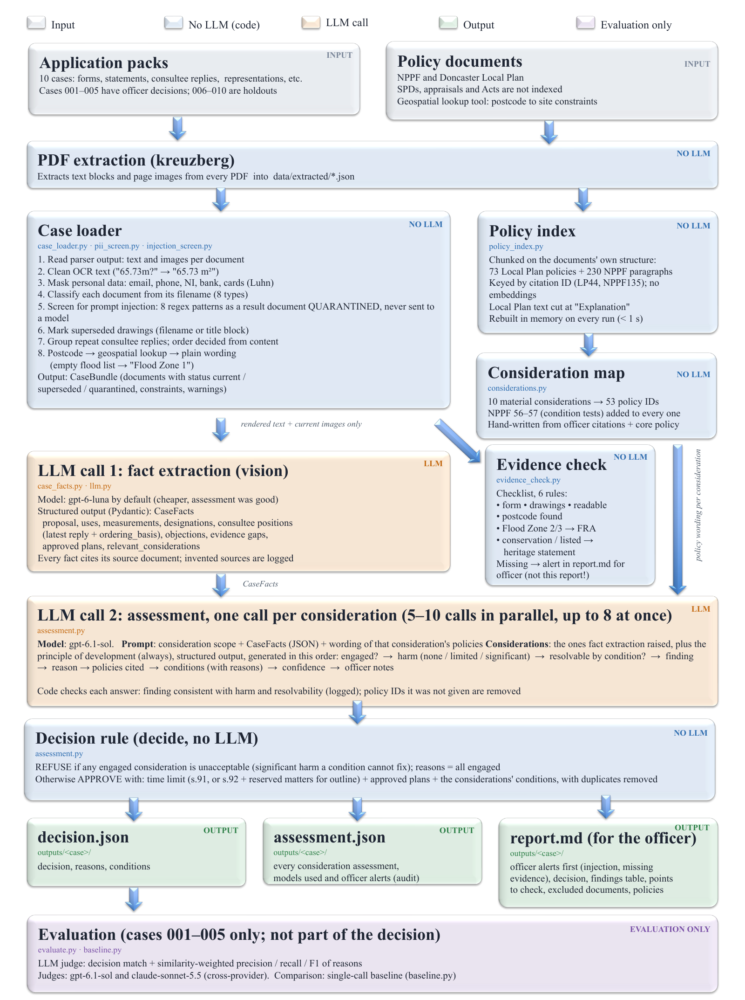

# Planning decision support

**Dr Mohsen Dorraki**

An LLM pipeline that reads a UK householder planning application and drafts the decision an officer would issue: **approve with conditions** or **refuse**, with reasons that cite the Doncaster Local Plan and the National Planning Policy Framework (NPPF). The draft goes to an officer for review and sign-off. It is not the decision itself.

It is a structured workflow, not an agent or a RAG system:

- every model call has one narrow job;
- policies are retrieved by the IDs officers cite, not by embeddings;
- the final outcome comes from a fixed rule that an officer can audit.



## Results

Five development cases with officers' real decisions, scored by an LLM judge for decision match and for reasons. The reasons score is similarity-weighted F1, so a reason earns more credit the closer it matches the officer's.

| Setup | Decision accuracy | Reasons F1 | Cost per case |
|---|---|---|---|
| Single call: whole pack → decision (baseline) | 0.60 | 0.32 | ~$0.07 |
| Pipeline, cheap model (gpt-6-luna) throughout | 0.80 | 0.43 | ~$0.02 |
| Pipeline, strong model (gpt-6.1-sol) throughout | 1.00 | 0.48 | ~$0.21 |
| **Pipeline, luna for facts + sol for judgement (default)** | **1.00** | **0.51** | **~$0.13** |

- **Second judge.** A judge from a different provider (Claude Sonnet) gave the same ranking. The pipeline's lead over the baseline was wider under that judge.
- **Run-to-run variation.** A full rerun scored 4/5: one borderline flood-risk consideration flipped.
- **Small sample.** Five cases is a very small set, and the prompts were developed on them. Treat these numbers as evidence for the design, not as an accuracy claim.

## How it works

| Stage | What it does | Model? | Code |
|---|---|---|---|
| 1. Extract | PDFs → per-page text and images (kreuzberg) | no | [`pdf_extract.py`](src/pdf_extract.py) |
| 2. Load and screen | Labels each document, masks personal data (Luhn-checked card numbers, phones, NI numbers), quarantines documents with prompt-injection text, sets superseded drawings aside, groups repeated consultee replies | no | [`case_loader.py`](src/case_loader.py), [`pii_screen.py`](src/pii_screen.py), [`injection_screen.py`](src/injection_screen.py) |
| 3. Policy index | Splits the Local Plan into its 73 policies and the NPPF into its 230 numbered paragraphs, keyed `LP44`, `NPPF135` | no | [`policy_index.py`](src/policy_index.py) |
| 4. Facts | One vision call turns the pack into a `CaseFacts` record, with a source for every fact; sources that don't exist are flagged | yes (cheap model) | [`case_facts.py`](src/case_facts.py) |
| 5. Assess | One call per material consideration (design, amenity, highways, flood risk, …), given only the policy wording mapped to it; calls run in parallel | yes (strong model) | [`assessment.py`](src/assessment.py), [`considerations.py`](src/considerations.py) |
| 6. Decide | Refuse if any engaged consideration is unacceptable; otherwise approve with standard and topic-specific conditions | no | `decide()` in [`assessment.py`](src/assessment.py) |
| 7. Check evidence | Rule-based check, like a council validation checklist: e.g. no flood risk assessment in Flood Zone 2/3 → officer alert | no | [`evidence_check.py`](src/evidence_check.py) |
| 8. Report | Officer report with alerts, a findings table, points to check and full citations | no | [`main.py`](src/main.py) |

Two details matter more than they look:

- **The refusal test is built into the output schema.** Structured-output fields are generated in order. So each assessment must state, *before* its finding, whether the consideration is engaged, how much harm it causes, and whether a lawful condition (NPPF 56–57) could resolve it. "Unacceptable" is reserved for significant harm that no condition can fix. The first prompt refused every case (1/5 correct). This ordering, together with an approve-by-default framing from NPPF paragraphs 11 and 39, raised that to 3/5. Later prompt fixes reached 5/5.
- **Code checks the model's output.** Policy IDs the model invents are dropped, and a finding that contradicts the model's own harm and condition answers is logged.

## Design trade-offs

| Decision | Alternative | Why this way | What it costs |
|---|---|---|---|
| Fixed pipeline | Multi-agent with orchestrator and critic | Each step can be checked, costs are predictable, and it's easy to evaluate | No cross-consideration "planning balance" beyond the rule |
| Retrieval by citation ID | Embedding search over policy chunks | Exact, free and auditable, and matches how officers cite | A policy outside the consideration map can't be cited |
| Rule decides the outcome | Model decides the outcome | Auditable; one model mistake can't silently flip the outcome | Rule is coarse; borderline findings flip decisions |
| Split models (cheap facts, strong judgement) | One model throughout | Same accuracy at ~40% lower cost: the cheap model reads well but judges poorly | Two models to monitor |
| Regex injection screen | LLM classifier | Deterministic and explainable to an officer | Only catches known phrasings |

The baseline ([`baseline.py`](src/baseline.py)) is kept so each of these choices is measured against the simplest alternative. Next steps I would test: self-consistency voting on borderline considerations, and an agentic policy lookup for considerations outside the map.

## Running it

Requires [uv](https://docs.astral.sh/uv/) and an [OpenRouter](https://openrouter.ai) API key.

```bash
uv sync
cp .env.example .env        # then add your OPENROUTER_API_KEY
```

### Data

The case packs and officers' decisions used in development came with a take-home assessment and are **not included**. The policy documents are public; download them from the official pages into `data/policies/`:

| Save as | Document | Source |
|---|---|---|
| `data/policies/nppf.pdf` | National Planning Policy Framework, December 2024 | [gov.uk](https://www.gov.uk/government/publications/national-planning-policy-framework--2) |
| `data/policies/local_plan.pdf` | Doncaster Local Plan, adopted 23 September 2021 | [doncaster.gov.uk](https://www.doncaster.gov.uk/services/planning/local-plan) |

Your own cases go in these places:

```
data/applications/<case-id>/*.pdf        # application form, drawings, statements, consultee replies
data/decisions/<case-id>/decision.json   # optional: officer's decision, for evaluation
data/site_constraints.json               # optional: constraints by postcode (see src/site_constraints.py)
```

Documents are typed from their filenames, e.g. `application_form.pdf`, `proposed_floor_plans.pdf` or `consultation_reply_highways.pdf`.

### Commands

```bash
uv run extract                   # PDFs → data/extracted/ (once)
uv run policy-index              # optional: write the policy index to JSON to inspect it
uv run case-loader case-001      # show how a pack is labelled and screened (no API calls)
uv run assess case-001           # draft → outputs/case-001/{report.md, assessment.json, decision.json}
uv run baseline case-001         # single-call baseline → outputs/baseline/
uv run evaluate                  # score outputs/ against data/decisions/
```

The fact-extraction and assessment models can be changed with `PLANNING_FACTS_MODEL` and `PLANNING_MODEL`. Model results are cached per model, so a rerun costs nothing; `--refresh` and `--refresh-facts` force fresh calls.

### Checks

```bash
uv run pytest      # unit tests for the deterministic stages
uv run ruff check src tests
uv run mypy
```

## Disclaimer

This project is not affiliated with or endorsed by City of Doncaster Council or the UK Government. Its outputs are illustrative drafts, not planning advice or decisions. The policy documents contain public sector information licensed under the [Open Government Licence v3.0](https://www.nationalarchives.gov.uk/doc/open-government-licence/version/3/).
